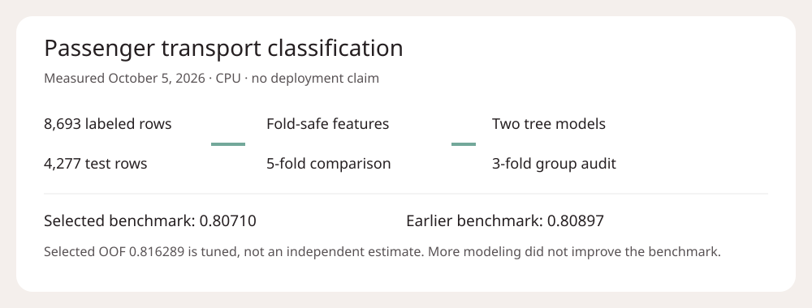
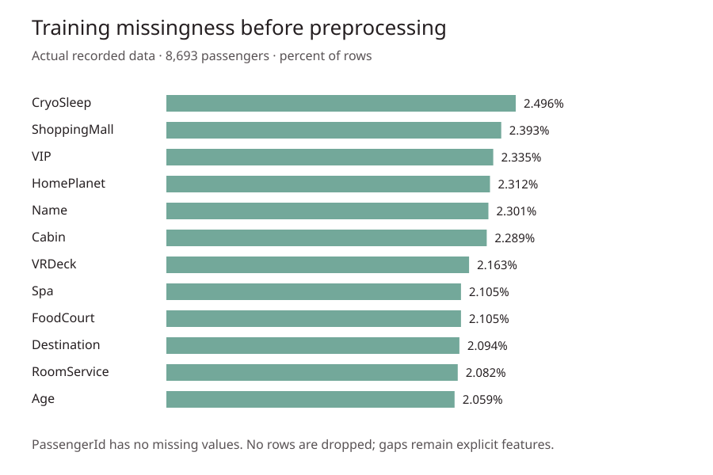

# Passenger transport classification

A tabular classification study with fold-safe imputation, two tree models, a passenger-group audit and checked prediction IDs.



## What the results say

This is an October 5, 2026 experiment, not a deployed transport system. The selected model scored **0.80710** benchmark accuracy, below the earlier **0.80897** result. More modeling did not improve the benchmark.

| Measurement | Accuracy |
|---|---:|
| CatBoost, five-fold out-of-fold | 0.812723 |
| LightGBM, same five folds | 0.814448 |
| Fixed equal blend, threshold 0.5 | 0.813873 |
| Selected 75% CatBoost blend, threshold 0.525 | 0.816289 |
| CatBoost, three group-disjoint folds | 0.815254 |
| Selected-model benchmark | 0.80710 |
| Earlier-model benchmark | 0.80897 |

The blend and threshold were chosen on these same out-of-fold predictions. Their selected score is development tuning, not an independent estimate. The group audit uses a different fold count and partition, so its score does not establish that group leakage helps or hurts. No ranking, medal or production performance is claimed.

## Data and informative EDA

8,693 labeled passengers, 4,277 test passengers. The labeled positive rate was 50.3624%. All supplied passengers are retained. The target is `Transported`; identifiers are used only for group features and output alignment, not as direct model inputs.



Missingness is about 2.1-2.5% in the affected fields, not zero. The indicators remain features. Missing spending is set to zero only when `CryoSleep` is true; otherwise the training fold's median is used. Zero observed spending does not establish cryosleep. Category gaps are an explicit `Missing` category.

## Workflow

1. Check unique passenger IDs and exact test/sample ID order.
2. Split cabins into deck, side and number; derive spending logs, missingness flags and age bins.
3. Count passenger groups and surnames across unlabeled train and test covariates. This is explicitly transductive. No targets are aggregated.
4. Fit fixed CatBoost and LightGBM settings on the same five stratified folds, with fold-only numeric medians and early stopping.
5. Compare fixed and selected blends. Run a separate three-fold passenger-group-disjoint CatBoost audit.
6. Check finite probabilities, boolean labels and exact output IDs; write local diagnostics and hashes.

## Run locally

Python 3.10+ and CPU. Install the dependencies, place the authorized `train.csv`, `test.csv` and `sample_submission.csv` together under `data/`, then run:

```bash
pip install -r requirements.txt
python train.py --data-dir data --output-dir outputs
```

`passenger_transport.ipynb` contains the complete workflow in cells, not a launcher. Set `DATA_DIR` and `OUTPUT_DIR` in its first cell and run in order. Outputs are intentionally empty; the recorded results above came from the measured run, not an execution of this portable edition. Package versions can change results; minimum ranges are not an exact environment lock. Four CPU threads per model; no paid services required.

Local outputs include fold metrics, blend search, group audit, plots, row-level predictions and a hash manifest. They are excluded from this repository. The code never sends or submits them anywhere.

## Limits

Synthetic benchmark data is not evidence of performance on real travelers. Surname counts can conflate unrelated passengers. Category vocabularies and counts use test covariates, so this is not a strictly inductive pipeline. Early stopping and blend selection reuse validation observations. There is no independent real-world holdout, fairness audit, deployed endpoint or inference service.

## License and credit

Copyright 2026 Parth Maniar. Original code and documentation: Apache-2.0. The official Spaceship Titanic dataset is CC BY 4.0 and is not bundled. Obtain authorized files from the original provider and retain their attribution. Libraries retain their own licenses.

Methods: [CatBoost](https://catboost.ai/docs/) · [LightGBM](https://lightgbm.readthedocs.io/) · [Group validation](https://scikit-learn.org/stable/modules/generated/sklearn.model_selection.StratifiedGroupKFold.html).

[GitHub profile](https://github.com/officialpm) · [Portfolio](https://www.parthmaniar.tech/)
